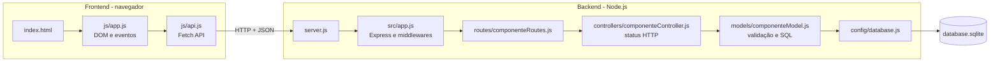

# LabParts

Sistema web para controlar os **componentes eletrônicos de um laboratório** (microcontroladores, sensores, resistores, módulos de comunicação): quantos existem, de que tipo são e em qual gaveta estão. Um CRUD completo (Criar, Ler, Atualizar e Excluir) com **backend em Node.js + Express + SQLite** e **frontend em HTML, CSS e JavaScript puro**.

Projeto da Quarta Etapa de Programação para Internet 2026 (IFPR Cascavel).
**Equipe:** Agatha e Vito

## Por que este tema

Laboratórios de eletrônica costumam controlar peças em planilhas ou de cabeça, e o resultado é descobrir que acabou o sensor no meio de um projeto. O LabParts resolve o essencial: cadastrar o componente, dizer onde ele está guardado e sinalizar quando o estoque está baixo (3 unidades ou menos) ou zerado.

## Estrutura

```
labparts/
├── backend/
│   ├── src/
│   │   ├── config/database.js                  # Conexão SQLite, criação da tabela e dados de exemplo
│   │   ├── controllers/componenteController.js # Decide status HTTP e resposta
│   │   ├── models/componenteModel.js           # Validação e consultas SQL da entidade
│   │   ├── routes/componenteRoutes.js          # Mapeamento dos endpoints
│   │   └── app.js                              # Express e middlewares
│   ├── server.js                               # Ponto de entrada
│   ├── tests.test.js                           # Testes da API (node:test)
│   └── package.json
└── frontend/
    ├── css/styles.css
    ├── js/api.js                               # Comunicação com o backend (Fetch API)
    ├── js/app.js                               # DOM e eventos
    └── index.html                              # Formulário e tabela
```

## Entidade: Componente

| Campo | Regra |
|---|---|
| `nome` | obrigatório, 2 a 100 caracteres |
| `categoria` | obrigatória: Microcontrolador, Sensor, Passivo, Atuador, Comunicação, Alimentação ou Outro |
| `localizacao` | opcional, até 60 caracteres (ex.: "Gaveta B2") |
| `quantidade` | inteiro maior ou igual a zero |
| `descricao` | opcional, até 500 caracteres |

## Arquitetura em camadas



Cada camada tem uma responsabilidade: o `api.js` é o único arquivo do frontend que usa `fetch`; o controller não escreve SQL; o model não conhece `req` e `res`. Por isso trocar o banco exige mexer só em `database.js` e no model.

## Endpoints

| Método | Rota | Corpo | Sucesso | Erros |
|---|---|---|---|---|
| GET | `/api/componentes` | — | 200 + lista (aceita `?busca=termo`) | — |
| GET | `/api/componentes/categorias` | — | 200 + categorias válidas | — |
| GET | `/api/componentes/:id` | — | 200 + componente | 400 ID inválido, 404 |
| POST | `/api/componentes` | `{ nome, categoria, descricao, localizacao, quantidade }` | 201 + criado | 400 validação |
| PUT | `/api/componentes/:id` | mesmo corpo do POST | 200 + atualizado | 400, 404 |
| DELETE | `/api/componentes/:id` | — | 204 sem corpo | 400, 404 |

Todos os erros seguem o formato `{ "erro": "mensagem" }`.

## Como rodar

Requisito: [Node.js](https://nodejs.org) 18 ou superior.

```bash
cd backend
npm install
npm start          # ou: npm run dev (reinicia ao salvar)
```

Abra **http://localhost:3000**. O backend também serve o frontend. Se preferir o Live Server do VS Code, também funciona (o CORS está liberado e o `api.js` aponta para a porta 3000). O banco `database.sqlite` é criado na primeira execução, já com alguns componentes de exemplo.

## Testes

```bash
cd backend
npm test
```

## Testando a API sem o frontend

```bash
curl http://localhost:3000/api/componentes
curl -X POST http://localhost:3000/api/componentes -H "Content-Type: application/json" \
     -d '{"nome":"DHT22","categoria":"Sensor","descricao":"Temperatura e umidade","localizacao":"Gaveta B1","quantidade":4}'
curl -X PUT http://localhost:3000/api/componentes/1 -H "Content-Type: application/json" \
     -d '{"nome":"ESP32-S3 DevKitC","categoria":"Microcontrolador","quantidade":5}'
curl -X DELETE http://localhost:3000/api/componentes/1
```

## Acessibilidade

- Todos os campos têm `<label>`; a tabela tem `caption` e cabeçalhos com `scope`.
- Mensagens de sucesso e erro ficam em região `aria-live`.
- Botões com rótulo completo, por exemplo "Excluir BMP280".
- Foco visível em todos os controles; a situação do estoque usa texto, não só cor.

## Publicando no GitHub

```bash
git init
git add .
git commit -m "LabParts: CRUD de componentes eletrônicos"
git branch -M main
git remote add origin https://github.com/SEU-USUARIO/labparts.git
git push -u origin main
```

## Próximos passos

1. Paginação na listagem.
2. Variáveis de ambiente com `.env`.
3. Registro de empréstimos (quem retirou e quando devolveu).
4. Autenticação com JWT nas rotas de escrita.
